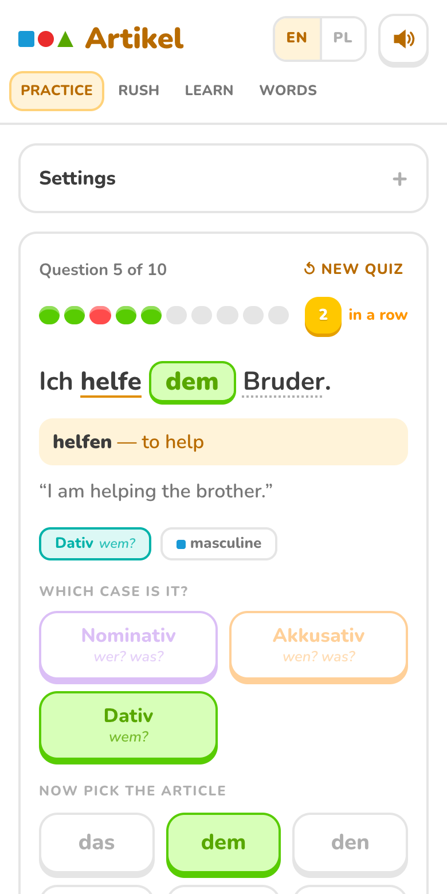
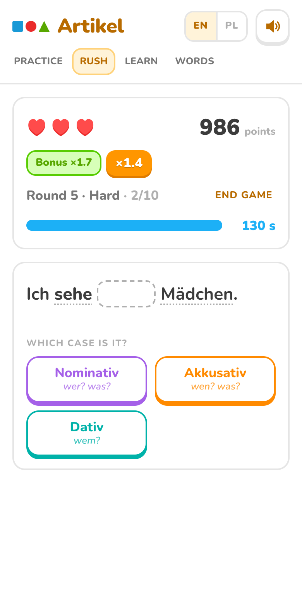
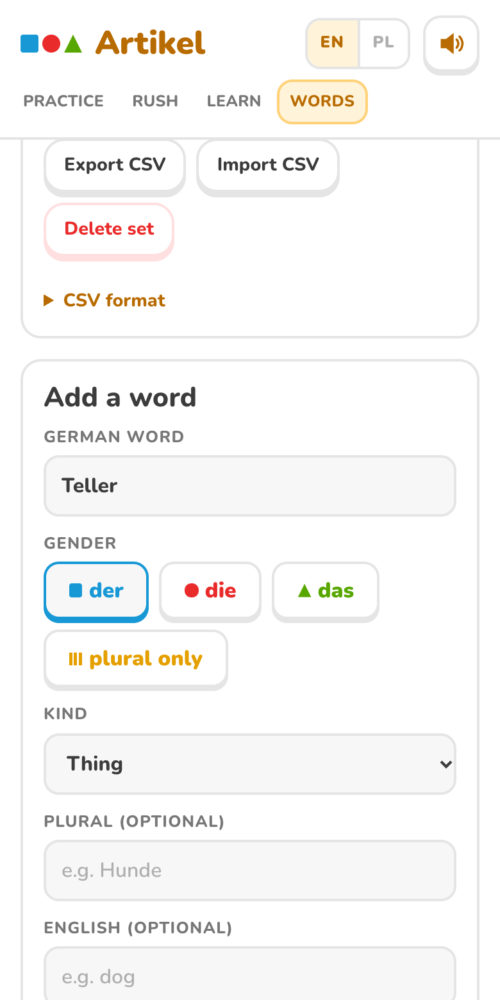
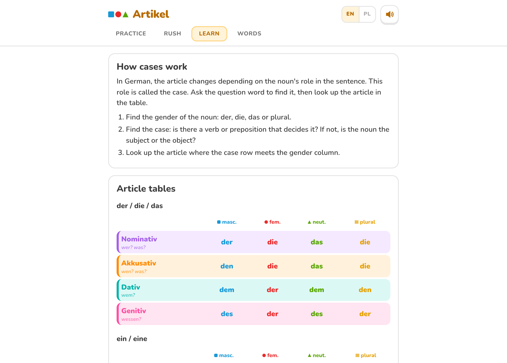

# Artikel Trainer

A small website for practising German articles (der/den/dem/des, ein/einen/einem/eines) in all four cases.
Pick the case, then the article, and see why it's right. In English or Polish, on phone or computer.

<p align="center">
  
  
  
</p>
<p align="center">
  
</p>

- **Practice:** sentences with a gap; choose the case first, then the article. Easy, Medium and Hard levels.
- **Artikel Rush:** a game with rounds that get harder, hearts, combos, a timer and high scores.
- **Learn:** a short guide to the four cases and the article tables.
- **Words:** two built-in word sets, plus your own sets with CSV import and export.

Plain HTML, CSS and JavaScript modules. No framework, no build step, no dependencies.

## Run

```sh
npm install      # once, installs the browser test tool
npm start        # serves on http://localhost:8000 (never cached, so edits show on refresh)
npm test         # logic and data tests (fast, Node only)
npm run test:e2e # browser tests: clicks through the app on desktop and phone sizes
npm run test:all # both
npm run screenshots # retakes the README screenshots (docs/screenshots/)
```

Browser tests use the Google Chrome installed on your computer.
The page must be served over HTTP (not opened as a file), because it uses JavaScript modules.
Any static host works (GitHub Pages, Netlify…): just upload the folder.

## Structure

```
index.html              page shell and tabs
css/styles.css          all styles (colour tokens at the top, dark mode included)
js/
  main.js               mounts the tabs
  settings.js           difficulty presets, defaults, saving to localStorage
  data/nouns.js         built-in word list ("Basics")
  data/nouns-everyday.js extra words of the "Everyday German" set (Basics + these)
  data/sentences.js     sentence templates
  grammar/articles.js   article tables and noun ending rules
  grammar/cases.js      tutorial text for each case
  quiz/generator.js     builds and checks questions (pure logic, no DOM)
  quiz/round.js         rounds of 10 questions and the end-of-round summary
  ui/                   one file per tab, plus small shared helpers
  ui/sound.js           sound effects (Web Audio, no audio files) and the mute button
  words/store.js        word sets: built-in + user sets, saved in the browser
  words/noun-input.js   turns typed words (form or CSV) into quiz nouns
  words/csv.js          CSV export and import
  i18n/index.js         interface language: t() lookup, plural forms, saved choice
  i18n/en.json, pl.json all interface texts, one JSON file per language
  data/nouns-pl.js      Polish forms of the built-in nouns, for Polish sentence translations
  progress.js           saves the current quiz so a refresh continues it
  game/rules.js         Artikel Rush: all game numbers (rounds, points, combo, hearts, timers)
  game/engine.js        Artikel Rush game logic (pure; the view passes in elapsed time)
  game/high-scores.js   Artikel Rush top 10, saved in the browser
  ui/question-card.js   one question with its answer area, shared by Practice and Rush
  ui/rush-view.js       the Rush tab
tests/                  Node tests for logic and data
e2e/                    Playwright browser tests
scripts/serve.js        development server (no caching)
```

## Adding content

- **Your own words:** use the Words tab in the app (no code needed). Sets can be exported and imported as CSV.
- **A built-in noun:** add a line to `js/data/nouns.js` (Basics) or `js/data/nouns-everyday.js` (only in
  Everyday German). Tags decide which sentences it can appear in. Weak nouns (der Junge → des Jungen)
  are not supported yet.
  Also add its Polish forms to `js/data/nouns-pl.js`; a data test checks they are there.
- **A sentence:** add a line to `js/data/sentences.js`. Use `{article} {noun}` for the gap and
  `{ist|sind}` for verbs that change with plural.
  Give it an English (`en`) and Polish (`pl`) translation, a `why` rule worded in the i18n files,
  and a `clue`: the word that decides the case, which players can tap to see its meaning.
  Every noun kind (person, animal, object, place) needs at least one sentence per case, so any word set works;
  a data test checks this.
- **A new article type** (e.g. kein, mein): add it to `ARTICLE_TYPES` in `js/grammar/articles.js`.
  It shows up in settings and tables automatically.

- **Interface text:** add the key to both `js/i18n/en.json` and `js/i18n/pl.json`, then use `t('your.key')`.
  A test fails if the two files have different keys or the code uses a key that doesn't exist.
- **Game rules (Artikel Rush):** edit `js/game/rules.js`. Add a round by adding a line to `rounds`;
  `level` is one of the difficulty presets in `js/settings.js`. Tests check the rules stay valid.
- **More article-like words** (kein, mein, dein, euer…): add an entry to `ARTICLE_TYPES` in
  `js/grammar/articles.js`, built with `einWord('mein')` (or `einWord('euer', { stem: 'eur' })`).
  Sentence translations would also need to say "my" instead of "a".
- **A new language:** add a JSON file with the same keys and register it in `LANGUAGES` in `js/i18n/index.js`.

Run `npm test` after changes. The data tests catch broken entries.
